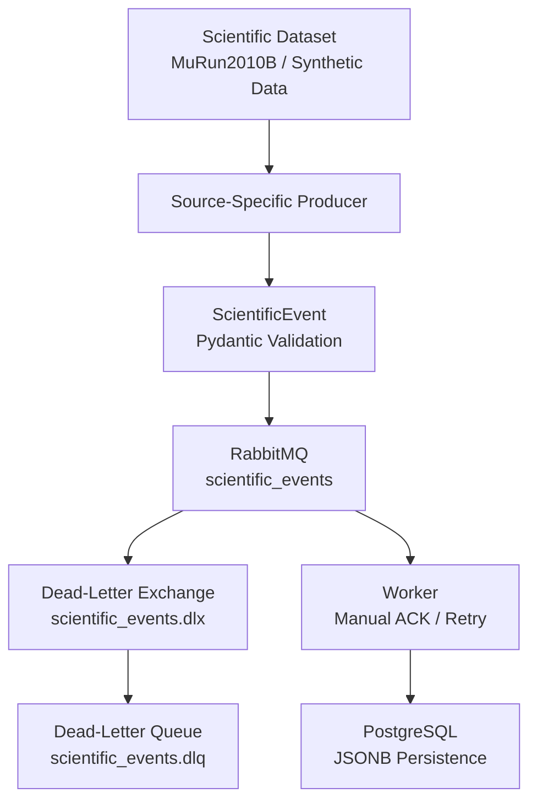

# Distributed Scientific Data Pipeline (DSDP)

A fault-tolerant, message-driven data pipeline for processing scientific datasets using Python, RabbitMQ, and PostgreSQL.

DSDP explores how scientific event data can be ingested, validated, transported, and persisted through a distributed architecture, with an emphasis on reliability, data integrity, reproducibility, and clear engineering boundaries.

## Project Overview

Scientific data pipelines must handle large volumes of events while maintaining data integrity and recovering from failures.

This project implements a distributed pipeline that:

- Ingests synthetic and real-world scientific event data.
- Converts source data into a common, validated event format.
- Transports events through RabbitMQ.
- Processes events using a dedicated worker.
- Persists validated events in PostgreSQL.
- Handles duplicate events, retries, and dead-letter routing.

The project currently uses a derived CMS MuRun2010B dimuon dataset containing 100,000 events.

## Architecture



### Processing Flow

1. A producer reads scientific data from its source.
2. Each record is converted into a standardized `ScientificEvent`.
3. Pydantic validates the event structure and payload.
4. The producer publishes persistent messages to RabbitMQ.
5. A worker consumes messages using manual acknowledgements.
6. Valid events are persisted in PostgreSQL.
7. Duplicate events are handled through idempotent persistence.
8. Failed messages are retried within a bounded retry policy; messages exceeding the retry limit are dead-lettered.

## Technology Stack

| Component | Technology |
|---|---|
| Language | Python 3.12 |
| Event validation | Pydantic |
| Message broker | RabbitMQ |
| Message transport | Pika |
| Database | PostgreSQL 16 |
| Database driver | Psycopg 3 |
| Structured storage | JSONB |
| Containerization | Docker |
| Configuration | python-dotenv |

## Implemented Components

### 1. Scientific Event Model

A common event envelope provides a consistent structure for different data sources.

The event model includes:

- Event ID
- Timestamp
- Source identifier
- Schema version
- Typed scientific payload

Pydantic is used to validate event structures before processing.

### 2. Data Producers

The project includes:

- A synthetic event producer.
- A CMS MuRun2010B dataset producer.

The source-specific producers convert their respective inputs into the common event format before publishing them.

### 3. RabbitMQ Message Transport

The message broker provides:

- Durable main queue.
- Persistent message delivery mode.
- Dead-letter exchange.
- Dead-letter queue.
- Manual message acknowledgement.
- Consumer prefetch limit of 1.

The main queue is configured with:

- Dead-letter exchange: `scientific_events.dlx`
- Dead-letter routing key: `scientific_events.dlq`

### 4. Worker Reliability

The worker implements:

- Manual acknowledgements.
- Bounded retry handling.
- Retry count tracking through message headers.
- Rejection of invalid messages.
- Dead-letter routing after retry exhaustion.
- Duplicate-event handling.

The current implementation uses a maximum of three persistence retries.

### 5. PostgreSQL Persistence

Scientific events are stored in the `scientific_events` table.

| Column | Type |
|---|---|
| event_id | UUID |
| timestamp | TIMESTAMPTZ |
| source | TEXT |
| schema_version | TEXT |
| payload | JSONB |

The event ID is the primary key, providing an idempotency mechanism against duplicate persistence.

## Dataset

### CMS MuRun2010B

The project uses a 100,000-event dimuon derived dataset associated with CMS Run2010B.

**Original dataset record:** [CERN Open Data — Record 700](https://opendata.cern.ch/record/cms-700)

**DOI:** `10.7483/OPENDATA.CMS.CB8H.MFFA`

The dataset is used as an educational and engineering data source for testing ingestion, event transformation, validation, messaging, and persistence.

It is not intended to represent a complete CMS physics-analysis dataset or reproduce official CMS physics results.

## Repository Structure

```text
distributed-scientific-data-pipeline/
│
├── api/
│   └── __init__.py
│
├── data/
│   └── raw/
│       └── MuRun2010B.csv
│
├── database/
│   └── __init__.py
│
├── docs/
│   └── architecture/
│       └── architecture_decisions.md
│
├── producer/
│   ├── __init__.py
│   ├── config.py
│   ├── detector.py
│   ├── murun2010b.py
│   └── producer.py
│
├── shared/
│   ├── constants.py
│   ├── events.py
│   └── payloads.py
│
├── storage/
│   ├── __init__.py
│   ├── base.py
│   └── postgres.py
│
├── worker/
│   ├── __init__.py
│   └── worker.py
│
├── .env.example
├── docker-compose.yml
├── fault_injection.py
├── redelivery_test.py
├── requirements.txt
├── test_producer.py
└── README.md
```

## Getting Started

### Prerequisites

- Python 3.12
- Docker Desktop
- Git

### 1. Clone the repository

```bash
git clone https://github.com/Jay-S9/distributed-scientific-data-pipeline.git

cd distributed-scientific-data-pipeline
```

### 2. Create a virtual environment

Windows CMD:

```cmd
python -m venv .venv

.venv\Scripts\activate
```

### 3. Install dependencies

```cmd
python -m pip install -r requirements.txt
```

### 4. Configure environment variables

Create a local `.env` file using the example:

```cmd
copy .env.example .env
```

Update the values in `.env` with your local PostgreSQL credentials.

Example:

```env
POSTGRES_DB=scientific_pipeline
POSTGRES_USER=pipeline
POSTGRES_PASSWORD=your_local_password
POSTGRES_HOST=localhost
POSTGRES_PORT=5432
```

Do not commit your private `.env` file.

### 5. Start PostgreSQL

```cmd
docker compose up -d postgres
```

The Compose configuration uses a named Docker volume to persist PostgreSQL data.

### 6. Start RabbitMQ

For a fresh local development environment:

```cmd
docker run -d --name rabbitmq --hostname rabbitmq -p 5672:5672 -p 15672:15672 -v rabbitmq_data:/var/lib/rabbitmq rabbitmq:management
```

RabbitMQ Management UI:

`http://localhost:15672`

Default local development credentials:

- Username: `guest`
- Password: `guest`

### 7. Configure RabbitMQ dead-letter topology

Before starting the worker, configure the dead-letter exchange and queue through the RabbitMQ Management UI.

**Create the exchange**

- Name: `scientific_events.dlx`
- Type: `direct`
- Durable: enabled

**Create the dead-letter queue**

- Name: `scientific_events.dlq`
- Durable: enabled

**Create the binding**

- Source exchange: `scientific_events.dlx`
- Destination queue: `scientific_events.dlq`
- Routing key: `scientific_events.dlq`

The application declares the main `scientific_events` queue with its dead-letter exchange and routing-key arguments.

### 8. Start the worker

Open a terminal in the repository root:

```cmd
python -m worker.worker
```

The worker connects to RabbitMQ and PostgreSQL, creates the database schema if necessary, and begins consuming messages.

### 9. Publish scientific dataset events

Open another terminal:

```cmd
python -m producer.murun2010b
```

The producer reads the MuRun2010B dataset and publishes standardized scientific events to RabbitMQ.

### 10. Verify the database

```cmd
docker exec scientific-postgres psql -U pipeline -d scientific_pipeline -c "SELECT COUNT(*) FROM scientific_events;"
```

To inspect a few records:

```cmd
docker exec scientific-postgres psql -U pipeline -d scientific_pipeline -c "SELECT event_id, timestamp, source, schema_version FROM scientific_events LIMIT 5;"
```

## Reliability and Verification

The project has been exercised through failure-oriented experiments.

Verified behaviours include:

- Persistent RabbitMQ messages.
- Manual acknowledgement.
- Bounded persistence retries.
- Dead-letter routing after retry exhaustion.
- Duplicate-event handling.
- Crash and message-redelivery behaviour.
- Idempotent PostgreSQL persistence.

A previous database verification returned:

```text
total_events  = 100002
unique_events = 100002
```

The RabbitMQ topology was also inspected to verify the durable main queue, dead-letter exchange, dead-letter queue, and their binding.

These results represent completed local experiments, not a production-scale performance benchmark.

## Engineering Principles

The project follows a few guiding principles:

1. **Understand before abstracting:** Build a clear understanding of each component before introducing additional infrastructure.
2. **Reliability over complexity:** Introduce mechanisms that address demonstrated failure scenarios.
3. **Data integrity:** Validate events and prevent duplicate persistence.
4. **Reproducibility:** Keep dependencies, configuration, and infrastructure setup documented.
5. **Visible failure handling:** Make retries, acknowledgements, and dead-letter routing explicit.
6. **Clear boundaries:** Keep producers, transport, workers, validation, and storage independently understandable.

## Roadmap

The following components are planned, not yet implemented:

- [ ] FastAPI read API.
- [ ] EventStore read interface.
- [ ] Grafana dashboards and pipeline observability.
- [ ] Event replay and controlled reprocessing.
- [ ] Improved retry backoff.
- [ ] Automated RabbitMQ topology provisioning.
- [ ] Expanded automated testing.
- [ ] Performance and throughput benchmarking.
- [ ] Multi-worker processing experiments.

## Disclaimer

This is an independent educational and engineering project using publicly available CERN Open Data.

CMS and CERN do not endorse this project or any conclusions derived from it. The dataset is used strictly as an engineering input for demonstrating distributed data processing concepts.

---

**Author:** [Jay S9](https://github.com/Jay-S9)

**Repository:** [Distributed Scientific Data Pipeline](https://github.com/Jay-S9/distributed-scientific-data-pipeline)
